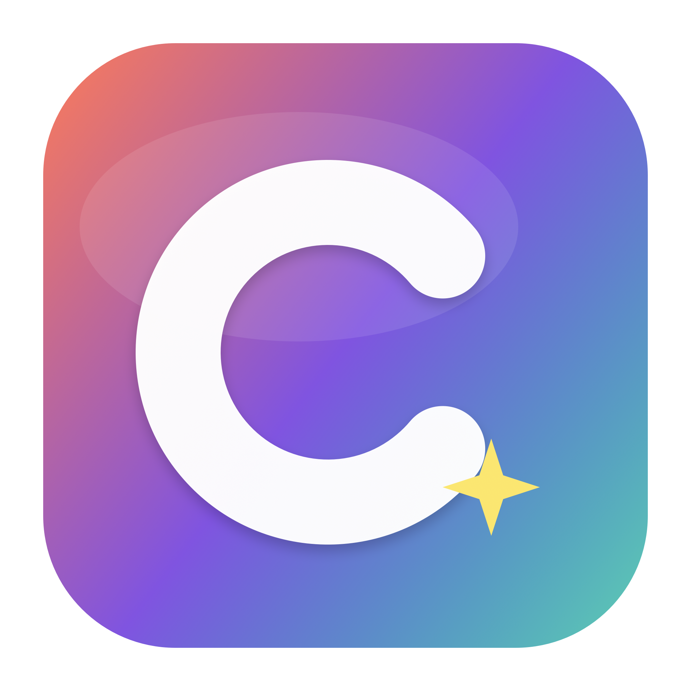
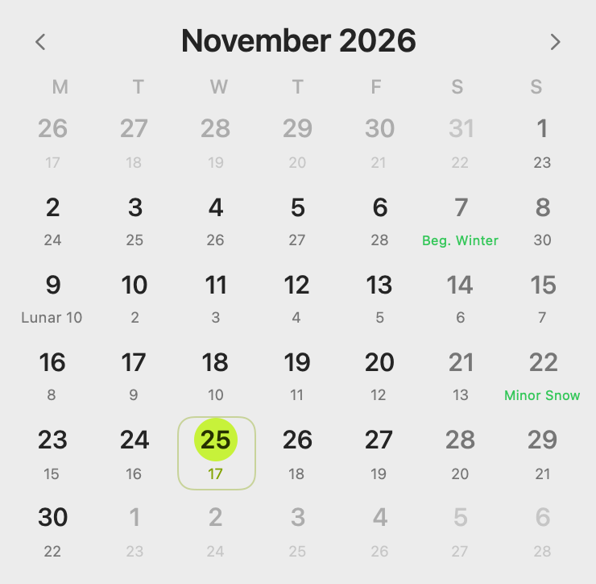

<div align="center">



# charl

**A tiny, native menu-bar toolbox for macOS: perpetual calendar, clipboard history, screenshot & pin.**

Lives in your menu bar. Left-click for the calendar, right-click for everything else.
No accounts, no telemetry, no Electron — just Swift, SwiftUI and AppKit.

[](LICENSE)
[](https://www.apple.com/macos/)
[](https://swift.org)
[](#build-from-source)
[](#build--test)

English · [简体中文](README.zh-CN.md)



</div>

---

## Why charl

Most menu-bar utilities are either a web view in a trench coat or a dozen separate apps.
charl is one small native binary that does four things well and stays out of your way:

- **Idle-cheap.** Modules load lazily; motion is event-driven and settles to zero CPU.
- **Native to the bone.** Real `NSVisualEffectView` glass, system semantic colors, dark mode,
  correct Retina / non-Retina rendering on every display.
- **Private by default.** Everything stays on disk in `~/Library/Application Support/charl`.
  The only network calls are optional, outbound-only weather / holiday lookups you can switch off.

## Features

| Module | What you get |
|---|---|
| **Calendar** | Lunar dates, Chinese festivals, solar terms, statutory holidays & make-up workday (Off/Work) badges; click a day for lunar detail, nearest-festival countdown and your events. Optional live weather for your IP-inferred city and real-time holiday updates. Three background modes (native glass / clear / solid), 10 accent presets + custom color, adjustable font size. |
| **Clipboard** | Colored type headers (text / link / image), a gravity "rope" with subtle event-driven motion, full-width auto + drag-resize, height & rope-opacity settings, capacity + eviction (pinned never auto-evicted), search & type filters. Follows the display under your mouse. |
| **Screenshot** | Instant freeze, region or window selection, arrow / rect / ellipse / pen / mosaic / **inline text** annotation, undo, native-resolution output, pin-to-screen, auto-save to `~/Pictures/charl`. |
| **Pin** | Float any clipboard image on screen, always on top. |
| **Hotkeys** | Editable global shortcuts with clear recording + saved feedback. |
| **Language** | Chinese and English UI. Follows your system language by default; override in Settings → General. Lunar dates, solar terms, festivals and holidays get English names (廿三 → 23, 立冬 → Beg. Winter); unknown names stay as written. |

Sensitive, transient, concealed or auto-generated pasteboard content (e.g. password-manager
writes) is **never recorded**. See [SECURITY.md](SECURITY.md) for the full privacy & network model.

## Install

### Build from source (recommended)

```bash
git clone https://github.com/char518/charl.git
cd charl
bash Scripts/build-app.sh --universal   # → dist/charl.app (x86_64 + arm64)
open dist/charl.app
```

Requires macOS 14+ and Xcode / Swift 5.9 toolchain. The app is ad-hoc / self-signed by default;
on first launch macOS may ask you to confirm (right-click → Open).

### Prebuilt DMG

Release DMGs are produced by `Scripts/notarize.sh`. Unless signed with a Developer ID and
notarized, Gatekeeper will warn — right-click → Open, or build from source instead.

## Permissions

| Permission | Why | Where |
|---|---|---|
| **Screen Recording** | capture the screen for screenshots | System Settings → Privacy & Security → Screen Recording |
| **Accessibility** | *optional:* auto-paste after choosing a clipboard item | System Settings → Privacy & Security → Accessibility |
| **Calendar** | *optional:* show your events on a selected day | System Settings → Privacy & Security → Calendars |

Core calendar / lunar / clipboard work without Accessibility or Calendar access;
screenshot needs Screen Recording.

## Privacy & network

- All data local: settings, clipboard history, images, holiday overrides, weather/holiday cache.
- **Optional, outbound-only** public-API GETs (no key, no personal data uploaded):
  city from IP (`ipwho.is`, fallback `ipapi.co`), weather (`wttr.in`, fallback `open-meteo.com`),
  statutory holidays (`holiday-cn` dataset mirroring State Council `gov.cn` notices).
  Your IP is used only to infer a city. Toggle in **Settings → Calendar → Show Weather / Auto-Update Holidays**.
- Results cached in `remote-cache.json` (weather 30 min, holidays 1 day); offline falls back to
  built-in 2026/2027 data plus your `holidays.json`.

Full details and vulnerability reporting: [SECURITY.md](SECURITY.md).

## Build & test

```bash
swift build                      # debug build
swift run CharlCoreTests         # 1507 core assertions (lunar, solar terms, holidays, settings, …)
swift run CharlIntegrationTests  # 72 integration checks (hotkeys, clipboard, capture, scaling, …)
bash Scripts/build-app.sh        # debug .app
bash Scripts/build-app.sh --universal   # release universal .app
bash Scripts/notarize.sh         # universal .app + DMG (optional Developer ID + notarization)
```

## Project layout

```
Sources/
  CharlCore/      # pure models: Day, lunar, solar terms, holidays, weather, settings, search
  CharlPlatform/  # service protocols (storage, clipboard, calendar, screenshot, hotkeys, remote)
  CharlMac/       # macOS implementations: EventKit, ScreenCaptureKit, pasteboard, Carbon hotkeys, …
  CharlUI/        # SwiftUI views + AppKit window/panel controllers
  CharlApp/       # entry point, menu-bar status item, offscreen renderer
Tests/
  CharlCoreTests/ CharlIntegrationTests/
Scripts/          # build-app.sh, notarize.sh, make-icon.swift, run.sh
Resources/        # Info.plist, AppIcon
```

The platform layer is protocol-based so a future Windows port can swap `CharlMac` for a
Win32 implementation without touching `CharlUI`.

## Contributing

Bug reports, feature ideas and PRs welcome — see [CONTRIBUTING.md](CONTRIBUTING.md).
Please run both test suites before opening a PR.

## License

[MIT](LICENSE) © charl