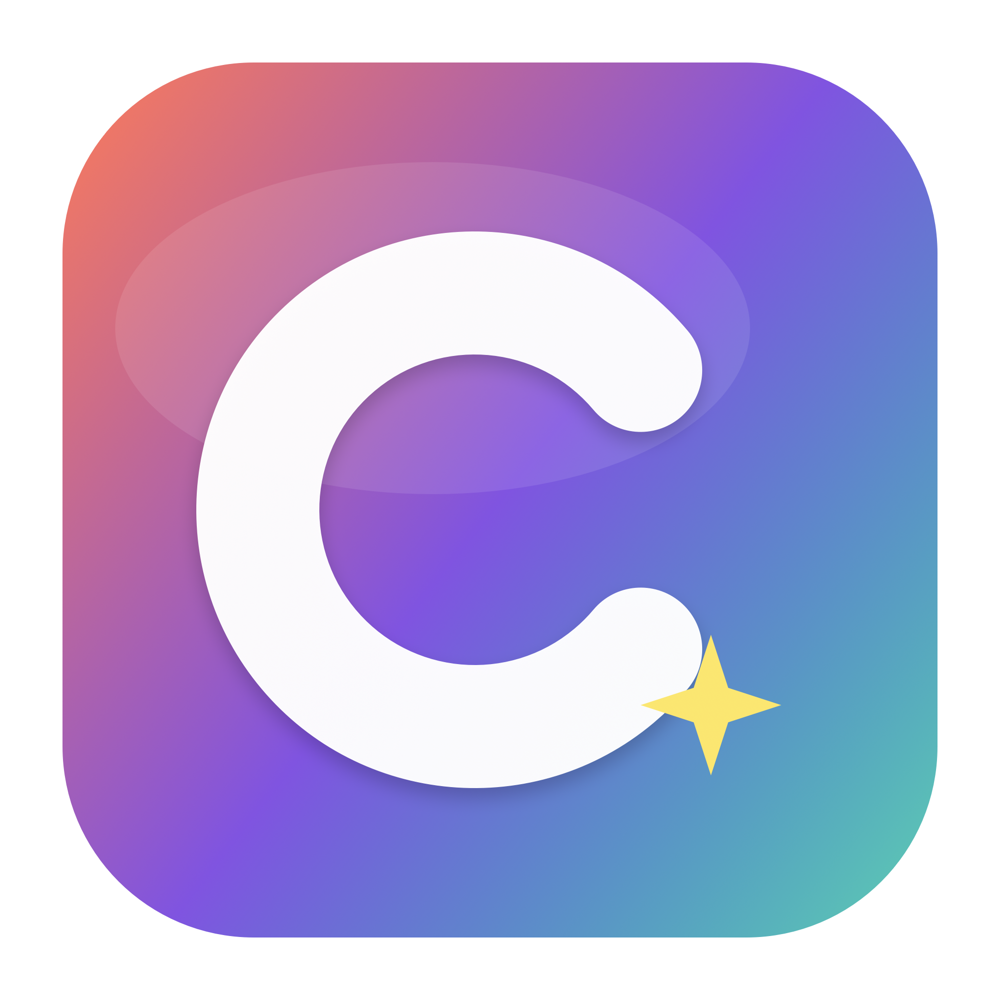
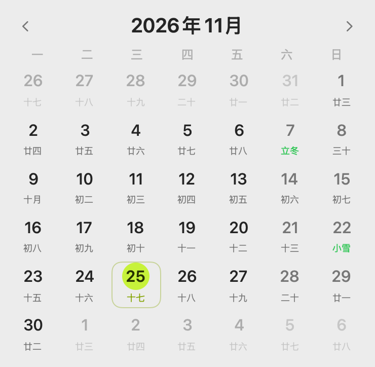

<div align="center">



# charl

**macOS 菜单栏原生小工具箱：万年历 · 剪贴板历史 · 截图 · 贴图。**

常驻菜单栏，左键打开万年历，右键呼出全部工具。
无账号、无遥测、非 Electron——纯 Swift / SwiftUI / AppKit。

[](LICENSE)
[](https://www.apple.com/macos/)
[](https://swift.org)
[](#从源码构建)
[](#构建与测试)

[English](README.md) · 简体中文



</div>

---

## 为什么是 charl

多数菜单栏工具要么是套壳网页，要么是一堆分散的小应用。charl 是一个原生小二进制，
把四件事做好、并且不打扰你：

- **空闲极省**：模块懒加载；动效事件驱动，静止后 CPU 归零。
- **原生质感**：真实 `NSVisualEffectView` 毛玻璃、系统语义色、深色模式、每块屏幕正确的 Retina / 非 Retina 渲染。
- **默认隐私**：全部数据留在本机 `~/Library/Application Support/charl`；唯一联网是可选、仅出站的天气/节假日查询，可关闭。

## 功能

| 模块 | 能力 |
|---|---|
| **万年历** | 农历、中国节日、节气、法定节假日与调休（休/班）角标；点击日期看农历、最近节日倒计时与日程。可选按 IP 定位城市显示实时天气、实时节假日更新。三种背景模式（原生玻璃/透明/纯色）、10 套强调色预设 + 自定义、字体大小可调。 |
| **剪贴板** | 文本/链接/图片彩色类型头、重力挂绳（事件驱动轻微动效）、全宽自适应＋拖拽调宽、高度与挂绳透明度可调、容量与淘汰（收藏永不自动淘汰）、搜索与类型过滤；面板跟随鼠标所在屏幕。 |
| **截图** | 瞬间定格、框选或选窗口、箭头/矩形/椭圆/画笔/马赛克/**区域内联文字**标注、撤销、原生分辨率输出、贴图到屏幕、自动保存到 `~/图片/charl`。 |
| **贴图** | 把剪贴板图片钉在屏幕最前。 |
| **快捷键** | 全局快捷键可编辑，录制与保存反馈清晰。 |
| **语言** | 中文与英文双语界面。默认跟随系统首选语言，可在设置 → 通用手动指定。农历、节气、节日与法定节假日在英文下给出对应英文名（廿三 → 23、立冬 → Beg. Winter），未收录的名称保持原文。 |

密码管理器等写入的敏感/临时/隐藏（Concealed/Transient/AutoGenerated）剪贴板内容**不记录**。
完整隐私与联网模型见 [SECURITY.md](SECURITY.md)。

## 安装

### 从源码构建（推荐）

```bash
git clone https://github.com/char518/charl.git
cd charl
bash Scripts/build-app.sh --universal   # → dist/charl.app（x86_64 + arm64）
open dist/charl.app
```

需要 macOS 14+ 与 Xcode / Swift 5.9 工具链。默认自签/_ad-hoc_ 签名，首次启动 macOS 可能要求确认（右键 → 打开）。

### 预打包 DMG

`Scripts/notarize.sh` 产出发布 DMG。若未用 Developer ID 签名并公证，Gatekeeper 会提示——右键 → 打开，或直接从源码构建。

## 权限

| 权限 | 用途 | 开启位置 |
|---|---|---|
| **屏幕录制** | 截图时读取屏幕内容 | 系统设置 → 隐私与安全性 → 屏幕录制 |
| **辅助功能** | 可选：选中剪贴板条目后自动粘贴 | 系统设置 → 隐私与安全性 → 辅助功能 |
| **日历** | 可选：显示某天的日程 | 系统设置 → 隐私与安全性 → 日历 |

万年历（农历）与剪贴板核心功能无需辅助功能/日历权限；截图必须开屏幕录制。

## 隐私与联网

- 全部数据仅在本机：设置、剪贴板历史、图片、节假日覆盖、天气/节假日缓存。
- **可选、仅出站**的公开接口 GET（无密钥、不上传个人数据）：按 IP 推断城市（`ipwho.is`，备用 `ipapi.co`）、天气（`wttr.in`，备用 `open-meteo.com`）、法定节假日（`holiday-cn` 数据集，镜像国务院办公厅 `gov.cn` 通知）。IP **仅**用于推断城市。可在 **设置 → 日历 → 显示天气 / 假日自动更新** 关闭。
- 结果缓存于 `remote-cache.json`（天气 30 分钟、节假日 1 天）；离线回退内置 2026/2027 数据与你的 `holidays.json`。

完整说明与漏洞上报：[SECURITY.md](SECURITY.md)。

## 构建与测试

```bash
swift build                      # debug 构建
swift run CharlCoreTests         # 1507 项核心断言（农历、节气、节假日、设置…）
swift run CharlIntegrationTests  # 52 项集成检查（快捷键、剪贴板、截图、缩放…）
bash Scripts/build-app.sh        # debug .app
bash Scripts/build-app.sh --universal   # release 通用 .app
bash Scripts/notarize.sh         # 通用 .app + DMG（可选 Developer ID + 公证）
```

## 目录结构

```
Sources/
  CharlCore/      # 纯模型：Day、农历、节气、节假日、天气、设置、搜索
  CharlPlatform/  # 服务协议（存储、剪贴板、日历、截图、快捷键、远程）
  CharlMac/       # macOS 实现：EventKit、ScreenCaptureKit、粘贴板、Carbon 快捷键…
  CharlUI/        # SwiftUI 视图 + AppKit 窗口/面板控制器
  CharlApp/       # 入口、菜单栏状态项、离屏渲染器
Tests/
  CharlCoreTests/ CharlIntegrationTests/
Scripts/          # build-app.sh、notarize.sh、make-icon.swift、run.sh
Resources/        # Info.plist、AppIcon
```

平台层基于协议，未来移植 Windows 时只需替换 `CharlMac` 为 Win32 实现，`CharlUI` 不动。

## 参与贡献

欢迎提 Bug、想法与 PR——见 [CONTRIBUTING.md](CONTRIBUTING.md)。开 PR 前请跑两套测试。

## 许可

[MIT](LICENSE) © charl